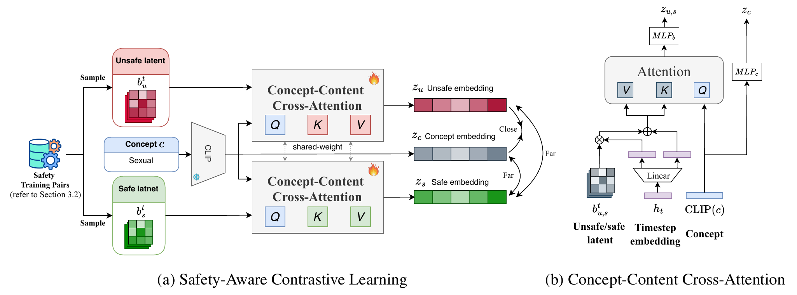

# GenShield: Generation-Time Defense for Text-to-Image Diffusion Models

📄 [Paper (PDF)](paper/GenShield.pdf)

GenShield detects unsafe content (sexual, violence, hate, ...) **while a diffusion model is still generating**,
so harmful generations can be stopped after a few denoising steps instead of being filtered after the fact.

Existing defenses trade one goal for the other:

| | Robust to rephrased / adversarial prompts | Responsive (decides before generation finishes) |
|---|:---:|:---:|
| Text-based classifiers (OpenAI Moderation, LatentGuard, GuardT2I) | ✗ | ✓ |
| Post-hoc image checkers (SD safety checker, Q16, NudeNet) | ✓ | ✗ |
| **GenShield (ours)** | ✓ | ✓ |

The key observation is that the bottleneck latents of the diffusion U-Net already encode what the final image will
contain, early in the denoising process. GenShield learns to read unsafe concepts from those latents with an
11M-parameter head and leaves the diffusion model itself untouched.

<p align="center"></p>

## Method

1. **Paired data generation.** For each unsafe concept *c*, an LLM writes an unsafe prompt *p<sub>u</sub>* and then
   rewrites it into a safe counterpart *p<sub>s</sub>* with the same scene and structure. Both prompts are
   generated from **the same initial noise**, and the U-Net mid-block latents *b<sup>t</sup>* are recorded at every
   step *t*. The resulting safe/unsafe latent pairs differ almost only in the unsafe concept.
2. **Concept-Content Cross-Attention (C3A).** The CLIP embedding of the concept is the query. The latent, modulated
   by the timestep embedding through FiLM, provides the keys and values. Two MLP heads project the attended latent
   and the concept into a shared 128-d space.
3. **Safety-aware contrastive learning.** A supervised contrastive loss pulls unsafe latents toward their concept
   embedding and pushes safe latents, and the other concepts, away.
4. **Early-stage inference.** At each denoising step, the cosine similarity between the latent and each concept
   embedding is compared with a threshold, and generation is halted as soon as one is exceeded. Existing images
   can be checked as well by obtaining their latents through DDIM inversion.

## Results

Stable Diffusion v1.5, DDIM with 50 steps, guidance 7.5. Full tables are in the paper.

**Defense against adversarial prompts** (average over SneakyPrompt, MMA-Diffusion, I2P-Sexual, I2P, Ring-A-Bell and P4D):

| Method | Type | AUROC ↑ | AUPRC ↑ | FPR@TPR95 ↓ | ASR ↓ |
|---|---|---:|---:|---:|---:|
| SD safety checker | post-hoc | 79.09 | 87.14 | 100.00 | 41.53 |
| NudeNet | post-hoc | 82.88 | 77.80 | 65.75 | – |
| OpenAI Moderation | text | 90.51 | 87.68 | 27.55 | – |
| LatentGuard | text | 75.53 | 72.95 | 71.15 | 50.52 |
| GuardT2I | text | 96.77 | 96.16 | 19.26 | – |
| **GenShield** | generation-time | **97.47** | **97.45** | **11.03** | **13.22** |

**Responsiveness.** Detection accuracy reaches about 90% within the first 10 of 50 steps and levels off at about
93% after step 20, so most unsafe generations can be stopped at 20% of the compute.

**Post-generation assessment on UnsafeBench** (F1, average over 7 categories, via DDIM inversion):
GenShield 0.716 vs. GPT-4V 0.700, InstructBLIP 0.535, LLaVA 0.520.

**Efficiency:** 11M parameters and 87 ms per check, vs. 290M parameters and 2.6 s for the SD safety checker.

## Installation

```bash
git clone https://github.com/<user>/GenShield.git && cd GenShield
pip install -e ".[data,dev]"          # add ,baselines for NudeNet
pytest                                 # CPU-only unit tests
```

## Usage

### 1. Precompute concept and timestep embeddings

```bash
python scripts/build_embeddings.py --out_dir data/embeddings
```

### 2. Build the training set

```bash
# LLM-generated unsafe/safe prompt pairs (any OpenAI-compatible endpoint; review the output by hand)
export OPENAI_API_KEY=...
python scripts/generate_prompt_pairs.py --concept violence --num_prompts 120 \
    --out data/prompts/prompts_violence.csv

# Paired latents: 5 seeds per prompt, with shared noise between the safe and unsafe halves
python scripts/extract_latents.py --pairs data/prompts/prompts_violence.csv \
    --out_dir "data/train/gen_violence_{kind}" --num_seeds 5

# Generic safe data: MS-COCO captions
python scripts/extract_latents.py --prompts coco_captions.txt --out_dir data/train/normal
```

### 3. Train

```bash
python scripts/train.py --config configs/genshield.yaml
```

Training takes about an hour on one 20 GB GPU. To train on a subset, edit `concepts:` in the config,
e.g. `concepts: [sexual]`.

### 4. Evaluate

Extract latents for each benchmark into `data/test/<name>`. Per-prompt seeds can be read from a column:

```bash
python scripts/extract_latents.py --prompts i2p_benchmark.csv --column prompt --seed_column sd_seed \
    --filter_column categories --filter_value violence --out_dir data/test/i2p_violence
python scripts/evaluate.py --config configs/genshield.yaml --checkpoint checkpoints/genshield/last.ckpt
```

This prints AUROC / AUPRC / FPR@TPR95 / F1 per suite and writes ROC/PR curves, score histograms and
accuracy-vs-step plots to `results/`.

For existing images (UnsafeBench), latents come from DDIM inversion:

```bash
python scripts/invert_images.py --unsafebench --split test --category violence --safety_label Unsafe \
    --out_dir data/test/unsafebench_unsafe_violence
python scripts/evaluate.py --config configs/genshield_unsafebench.yaml --checkpoint ...
```

### 5. Shielded generation

```bash
python scripts/generate.py --checkpoint checkpoints/genshield/last.ckpt --prompt "a cozy cabin in the snow"
# Safe. Saved output.png
# Max similarity per concept: hate=0.112, harassment=0.087, ...
```

Unsafe prompts are blocked mid-generation (`Blocked at step 9/50: 'violence' (score 0.912)`) and no image is
decoded. To use GenShield inside your own `diffusers` code:

```python
from genshield import GenShield, shielded_generate

shield = GenShield.from_files("last.ckpt", "data/embeddings/concepts.pt", "data/embeddings/timesteps.pt")
image, report = shielded_generate(pipe, shield, prompt)   # image is None if blocked
```

### Baselines

```bash
python baselines/score_images.py --method nudenet --image_dir data/test/mma_adv_sexual/image \
    --out results/baselines/nudenet/mma_adv_sexual.json
python baselines/evaluate.py --safe results/baselines/nudenet/normal.json \
    --unsafe results/baselines/nudenet/*.json
```

Q16 and LatentGuard scores from their official repositories can be read with `--format q16_csv` and `--format latentguard`.

## Data layout

```
data/
├── embeddings/{concepts,timesteps}.pt
├── prompts/prompts_<concept>.csv          # unsafe_prompt,safe_prompt
├── train/{normal, gen_<concept>_safe, gen_<concept>_unsafe, unsafebench_{safe,unsafe}_<concept>}/latents_*.pt
└── test/{normal, i2p_<concept>, mma_adv_sexual, sneakyprompt_sexual, ring_a_bell_sexual, p4d_n_sexual, ...}/latents_*.pt
```

Each `latents_*.pt` stores `{"latents": [50, 1280, 8, 8] fp16, "prompt": str, "seed": int}`, about 8 MB per
generation. Benchmarks are not redistributed. Get them from their authors:
[I2P](https://huggingface.co/datasets/AIML-TUDA/i2p),
[MMA-Diffusion](https://github.com/cure-lab/MMA-Diffusion),
[SneakyPrompt](https://github.com/Yuchen413/text2image_safety),
[Ring-A-Bell](https://github.com/chiayi-hsu/Ring-A-Bell),
[P4D](https://github.com/joycenerd/P4D),
[UnsafeBench](https://huggingface.co/datasets/yiting/UnsafeBench).

## Repository structure

```
genshield/          # library
  model.py          # C3A: FiLM + concept-query cross-attention + projection heads
  losses.py         # supervised contrastive loss
  hooks.py          # records U-Net mid-block latents with a forward hook (works with stock diffusers)
  detector.py       # GenShield: scores latents against concepts at any step
  data.py           # latent datasets
  embeddings.py     # concept and timestep embeddings
  metrics.py, plotting.py
scripts/            # pipeline: prompt pairs → latents → train → evaluate → shielded generation
baselines/          # post-hoc checker scoring and evaluation
configs/            # experiment configs
tests/
```

## Responsible use

This repository is for building defenses. The prompt-generation script asks an LLM to write unsafe captions
and the extraction scripts render them, so generated data may contain harmful imagery. Keep it out of version
control (`data/` is git-ignored) and handle it according to your institution's policies.

## License

[MIT](LICENSE)
